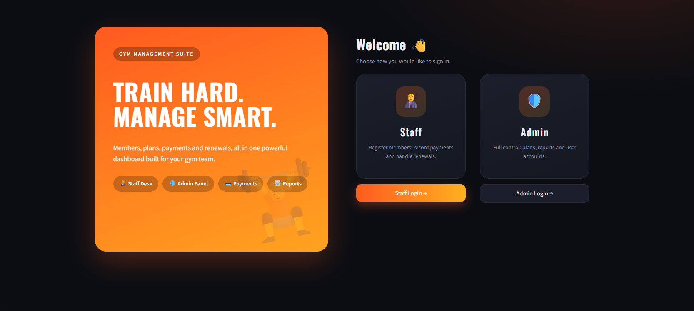
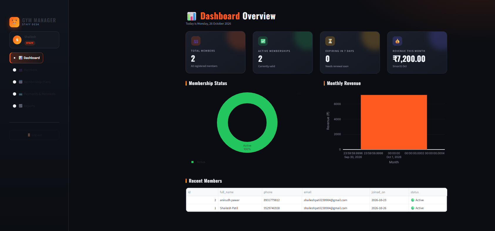
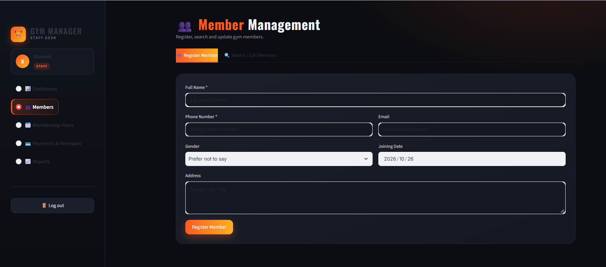
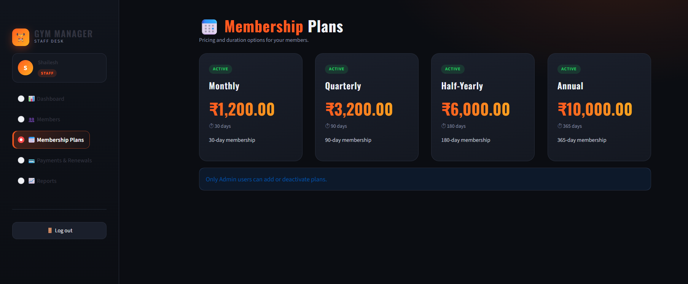
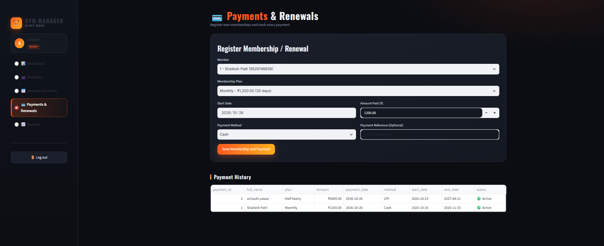

# 🏋️ Gym Membership Management System

A beginner-friendly gym management application built using **Python, Streamlit, and SQLite**. It helps gym administrators and staff manage gym members, membership plans, payments, and reports through a simple web interface.

## 📌 About the Project

Managing gym memberships manually can be time-consuming. This project provides a digital solution for organizing member details, membership plans, and payment records in one place.

This application was developed as an academic mini project to demonstrate Python programming, database connectivity, authentication, and web application development.

## ✨ Features

- 📊 **Dashboard:** View gym management summaries and charts.
- 👥 **Member Management:** Register, search, view, and update members.
- 📋 **Membership Plans:** Manage available membership plans.
- 📝 **Membership Registration:** Manage member memberships.
- 💳 **Payment Management:** Record and view payment details.
- 📈 **Reports:** View records and download supported reports as CSV files.
- 🔐 **Role-Based Login:** Separate Admin and Staff access.
- 🗄️ **SQLite Database:** Store application data locally.
- 📱 **Web Interface:** Access the application through a browser.

## 🛠️ Technology Stack

| Technology | Purpose |
|---|---|
| Python | Application logic |
| Streamlit | User interface |
| SQLite | Database |
| Pandas | Data handling and reports |
| Matplotlib / Seaborn | Data visualization, where used |

## 📁 Project Structure

```text
Gym-Membership-Management-System/
│
├── app.py
├── auth.py
├── database.py
├── requirements.txt
├── README.md
├── .gitignore
│
└── screenshots/
    ├── dashboard.png
    ├── login.png
    ├── member.png
    ├── membership_plans.png
    └── payments.png
```

**File descriptions:**

- `app.py` — Main application.
- `auth.py` — Authentication and access control.
- `database.py` — Database initialization and operations.
- `requirements.txt` — Required Python packages.
- `README.md` — Project documentation.
- `.gitignore` — Prevents selected local and sensitive files from being tracked.
- `screenshots/` — Application screenshots.

## 🚀 Installation and Setup

Follow these steps to download and run the project on your computer.

### Prerequisites

Install the following:

- Python compatible with the packages in `requirements.txt`
- Git (optional if downloading the ZIP)
- VS Code or another code editor

Download Python: https://www.python.org/downloads/

### Step 1: Download the Project

**Option A — Download ZIP**

1. Visit the [GitHub repository](https://github.com/shailesh-23-patil/Gym-Membership-Management-System).
2. Click the green **Code** button.
3. Select **Download ZIP**.
4. Extract the ZIP file.
5. Open the extracted folder in VS Code.

**Option B — Clone using Git**

Open a terminal and run:

```bash
git clone https://github.com/shailesh-23-patil/Gym-Membership-Management-System.git
cd Gym-Membership-Management-System
```

### Step 2: Open the Terminal

In VS Code, select **Terminal → New Terminal**.

Make sure the terminal is inside the project folder containing `app.py`.

### Step 3: Create a Virtual Environment

For Windows:

```powershell
python -m venv .venv
```

### Step 4: Activate the Virtual Environment

For Windows PowerShell:

```powershell
.\.venv\Scripts\Activate.ps1
```

For Windows Command Prompt:

```cmd
.venv\Scripts\activate.bat
```

After activation, `(.venv)` should appear at the beginning of your terminal prompt.

### Step 5: Install Dependencies

Run:

```bash
python -m pip install --upgrade pip
pip install -r requirements.txt
```

Wait for all packages to finish installing.

### Step 6: Run the Application

Run the following command:

```bash
python -m streamlit run app.py
```

Streamlit should provide a local address. Open it in your browser; the default is usually:

http://localhost:8501

### Step 7: Log In

Use the login page and the credentials configured for your local application. Follow any account setup instructions provided by the project.

Do not assume that a default account exists unless it is configured in the source code. Change any demo or default password before using the application with real data.

**🎉 The application is now ready to use!**

## 🔐 User Roles

The application supports two roles:

- **Admin:** Access to administrative features, including user management where enabled.
- **Staff:** Access to permitted gym management features.

The available operations depend on the permissions implemented in the application.

## 📸 Screenshots

### Login Page



### Dashboard



### Member Management



### Membership Plans



### Payment Management



*Note: Use sample data in public screenshots. Remove or blur real names, phone numbers, email addresses, and other private information.*

## 🧰 Troubleshooting

### Python is not recognized

Check whether Python is installed:

```bash
python --version
```

On Windows, you can also try:

```bash
py --version
```

### Streamlit is not recognized

Activate the virtual environment and install the dependencies:

```bash
python -m pip install -r requirements.txt
```

Then run:

```bash
python -m streamlit run app.py
```

### Application does not open

Check the terminal for error messages. If necessary, open:

http://localhost:8501

### Database errors

Make sure the project folder is writable and check `database.py` for the database initialization logic and database path.

### Port already in use

Run the application on another port:

```bash
python -m streamlit run app.py --server.port 8502
```

Then open http://localhost:8502.

## 🔮 Future Enhancements

Possible improvements include:

- Membership expiry notifications
- Automatic renewal reminders
- PDF report generation
- Password change and reset functionality
- Improved dashboard analytics
- Secure cloud deployment

These are potential improvements and may not be available in the current version.

## 👨‍💻 Author

**Shailesh Patil**

GitHub Profile: https://github.com/shailesh-23-patil

Project Repository: https://github.com/shailesh-23-patil/Gym-Membership-Management-System

---

⭐ If you find this project helpful for learning, feel free to explore the code and build on it.

**Disclaimer:** This project is intended for educational purposes. Review authentication, data protection, and deployment security before using it with real gym members.
